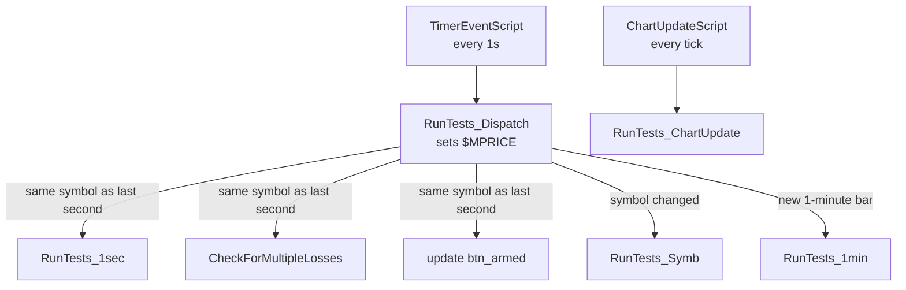

# DAS-Hotkeys

Scripts for **DAS Trader Pro** that run a rules-based, long-only, small-cap momentum strategy. They:

- grade the current symbol against a checklist and show the results as coloured buttons on the chart and ladder;
- read out price action, candle patterns and warnings by voice;
- make you **arm** a setup, which only works if the setup passes the non-negotiable rules, before an entry hotkey will trade;
- size each entry from a fixed dollar risk and send it with a stop-limit order attached;
- lock the montage after two losing trades in a row.

These are plain DAS script files with no file extension. They don't run from this repo: each one is copied by hand into a DAS hotkey or button script, or into one of the event hooks under Setup. Changing a file here does nothing until you paste it into DAS.

---

## Contents

- [Required DAS layout](#required-das-layout)
- [How the scripts are triggered](#how-the-scripts-are-triggered)
- [Trading workflow](#trading-workflow)
- [Arming rules (SpeakTestResults)](#arming-rules-speaktestresults)
- [Entry hotkeys](#entry-hotkeys)
- [Exit hotkeys](#exit-hotkeys)
- [Risk controls](#risk-controls)
- [Chart levels](#chart-levels)
- [Test scripts](#test-scripts)
- [Button scripts](#button-scripts)
- [Shared global variables](#shared-global-variables)
- [Hotkey names vs. filenames](#hotkey-names-vs-filenames)
- [Legacy: DynamicSizing/](#legacy-dynamicsizing)
- [DAS behaviour to know](#das-behaviour-to-know)
- [Deploying changes](#deploying-changes)

---

## Required DAS layout

The scripts find windows and studies by name, so your DAS layout must use these exact names.

### Windows

| Window name | Global variable | Used for |
|---|---|---|
| `Chart1` | `$CHART1` | Main 1-minute chart: bars, studies, most custom buttons, drawn lines |
| `Chart5` | `$CHART5` | 5-minute chart: 9 EMA copied onto Chart1 |
| `ChartDaily` | `$CHARTD` | Daily chart: 200 SMA/EMA, 9/20 EMA, 10-day volume |
| `MONTAGE1` | `$MONTAGE1` (also `$M`) | Orders, position, bid/ask, high/low of day, account |
| `LADDER1` | `$LADDER1` | Dip, curl and pattern buttons |

### Studies

| Window | Study name | Read by |
|---|---|---|
| Chart1 | `StudyBar` | `RunTests_Dispatch` sets `$MPRICE`, the current price used everywhere |
| Chart1 | `Study9EMA`, `Study20EMA`, `Study200EMA` | EMA alignment, trend, extension, dip, curl |
| Chart1 | `StudyVWAP` | VWAP test, dip |
| Chart1 | `StudyMACD` | MACD test |
| Chart5 | `Study9EMA` | `Draw5MinEMA` |
| ChartDaily | `StudyD200SMA`, `StudyD200EMA`, `StudyD9EMA`, `StudyD20EMA` | Daily test, key resistance lines |

### Custom buttons

**Chart1:** `btn_arm`, `btn_armed`, `btn_pausetests`, `btn_mute`, `btn_news`, `btn_price`, `btn_float`, `btn_gap`, `btn_rvol`, `btn_vol`, `btn_spread`, `btn_vwap`, `btn_macd`, `btn_emas`, `btn_ematrend`, `btn_dailyavgs`, `btn_etb`, `btn_extended`, `btn_range`, `btn_risk`, `btn_stop`, `btn_riskpershare`, `btn_shares`, `btn_plannedrisk`, `btn_candle_type`, `btn_candle_confirmation`, `btn_st_interpret`

**LADDER1:** `btn_dip`, `btn_curl`, `btn_pattern`, `btn_speakdipaction`, `btn_speakcurlaction`

### Button colours

The buttons use the same colours throughout:

| Colour | Meaning |
|---|---|
| Green | Good / passes |
| Orange | Caution / warning |
| Red | Bad / blocker |
| Light gray `color(211,211,211)` | Neutral / no signal |

---

## How the scripts are triggered

Three DAS event hooks drive everything:

| Hook (DAS setting) | Script | Runs |
|---|---|---|
| Desktop load | `DesktopLoadScript` | Once, when the layout loads. Saves the windows as global variables and initialises `$SpeakCandleAction=1` and `$SetupArmed=0`. |
| Timer event (1 second) | `TimerEventScript` → `RunTests_Dispatch` | Every second |
| Chart update | `ChartUpdateScript` → `RunTests_ChartUpdate` | On every chart tick |

`RunTests_Dispatch` decides which group of tests to run:



| Group | Scripts, in run order |
|---|---|
| **RunTests_1sec** | TestExtended, TestVolume, TestStop, Test_ST_RVOL10, Test_Candle_Color, Test_Candle_Type, Test_ST_PriceContext, Test_ST_InterpretVol, Test_Retracement, Test_Pattern, Test_Dip, Test_Curl, Speak_Price_Action, Draw5MinEMA |
| **RunTests_ChartUpdate** | TestPrice, TestVWAP, TestGap, TestRVOL, TestSpread, Test_PriceChange |
| **RunTests_1min** (new candle) | Test_MarketHours, TestDaily, TestMACD, TestEMAAlignment, TestEmaTrendState |
| **RunTests_Symb** (symbol change) | Setup Disarmed, CatalystButtonColor, TestFloat, TestETB, TestDaily, TestMACD, TestEmaTrendState |

Things to know:

- **Order matters within a group.** Later scripts read globals that earlier ones set. For example, `Test_Retracement` sets `$SESSIONLOW`, `$SESSIONHIGH` and `$RETRACE50` for `Test_Dip`, and `Test_ST_PriceContext` sets `$PricePosition` for `Test_ST_InterpretVol` and `Speak_Price_Action`. Values set in another group (such as `$PriceChange` from ChartUpdate) are at most one tick old.
- **Each group has a guard that stops it running twice at once.** `$RunningTests1s`, `$RunningTestsChart`, `$RunningTests1` and `$RunningTestsSymb` are set to 1 while their group runs.
- **The Pause Tests button turns the test groups on and off** through `$RunTestsEnabled`. `DesktopLoadScript` doesn't set it, so after a restart the tests stay off until you click the button. `CheckForMultipleLosses` runs from the dispatcher directly, so it keeps running while the tests are paused.

---

## Trading workflow

1. **Load a symbol.** `RunTests_Symb` disarms any armed setup, then fills in the buttons that only change with the symbol: float, ETB/SSR, daily averages, MACD and EMA trend.
2. **Read the buttons.** The 1-second, chart-update and 1-minute tests keep the rest of the board current.
3. **Set the catalyst.** Click the news button (`Catalyst`) to cycle the symbol through: not set → has news (green) → no news (orange) → red flag (red) → not set.
4. **Place your stop price.** Set the montage price to your stop, usually by clicking the chart. `TestStop` shows the planned shares, risk per share and risk in R.
5. **Arm the setup.** The Arm button (`ArmSetup`) runs `Setup Armed`, which runs `SpeakTestResults`:
   - If a non-negotiable rule fails, it speaks the reason, then "Non-Negotiable.", and stays disarmed.
   - Otherwise it reads out any warnings and arms: `$SetupArmed=1`, the button turns orange and you hear "Setup armed."
   - While armed, `TestStop` draws a green 1R target line (`R1`) and a red stop line (`S1`) on Chart1.
6. **Enter.** `DynamicEntry` or `StaticEntry` refuses to trade unless the setup is armed. Entering uses up the arm (`$SetupArmed=0`), so every trade needs a new arm.
7. **Manage the trade.** While armed or in a position, `Speak_Price_Action` reads out volume events and candle closes. Use `SellPortionAsk` or `SellPortion` to take partials and move the stop to breakeven.
8. **Discipline.** `CheckForMultipleLosses` locks the montage after two losing trades in a row.

The setup also disarms automatically when the symbol changes (if the tests are running), or when `TestExtended` finds the candle range too large.

---

## Arming rules (SpeakTestResults)

### Non-negotiables (any one blocks arming)

| Rule | Fails when | Source |
|---|---|---|
| Price | `$MPRICE > 20` | RunTests_Dispatch |
| Float | `$Float > 20` (millions) | TestFloat |
| Gap | `$GAP <= 10` (%) | TestGap |
| Relative volume | `0 < $RVOL <= 5` | TestRVOL |
| Candle range ("Candle range too large.") | 4-candle average range > 25% of price (`$Rng4Pct`) | TestExtended |
| Spike ("Candle is too large for this stock.") | The bigger of the last two candles (the forming one and the one before) is ≥ 2.5× the average range of the 8 candles before them (`$SpikeMultiple`) **and** ≥ 8% of price (`$SpikePct`) | TestExtended |
| Volume | `$VOL < 750,000` | TestVolume |
| Near the high | Price within $0.10 of the montage high | MONTAGE1 |
| Below VWAP with no confirmation | Below VWAP and the curl check is blocked or cautious | TestVWAP, Test_Curl |

A symbol with no previous close (usually an IPO) shows a gap of 0, so it fails the gap rule. An RVOL of exactly 0 (no data) is **not** blocked.

### Warnings (spoken, don't block)

- Price above $10
- Below VWAP
- MACD closed
- Within 5% under the daily 200 EMA or SMA
- Easy to borrow
- 4-candle average range above 10% of price
- Extended from the 9 EMA
- EMA trend sideways or down (nothing is said while the chart is too short to tell, `$EMA_TREND_STATE` 0)
- Wide spread (> $0.10) or moderate spread (> $0.05)
- Catalyst marked "no news" or red
- No reversal confirmed yet
- Price below the highest-volume candle's low

---

## Entry hotkeys

Both entry hotkeys:

- refuse to trade unless the setup is armed;
- reject a stop at or above the bid, or less than $0.05 below the entry;
- route to `ARCA1L` on every account (`ARCAL` is no longer available on either the training or the margin account);
- send a limit buy at the ask with `TIF=DAY+`, and attach a stop-limit sell for the whole position;
- leave the montage price set to the stop afterwards.

### DynamicEntry (risk-based size)

| Setting | Value |
|---|---|
| `$MaxShares` | 25 |
| `$MaximumRiskPerTrade` | `$MaxShares * .15` = **$3.75** |
| `$StopLimitPriceOffset` | $0.05 (stop-limit price = stop − $0.05) |
| `$MaxLongVal` | $2,000 position value cap |

```
risk per share = (ask − stop) + 0.05
shares         = Round(3.75 / risk per share), capped at 25 and at $2,000 of position value
```

It also cancels all open orders for the symbol first, and refuses to trade if you already hold a long position. (The `$Debug` option that showed the calculation in a `MsgBox` was removed.)

Known limitation: DAS's script editor reports `missing ;` on the `TriggerOrder` line when you commit the hotkey. It still saves, and the stop is attached. Keep the line unquoted, as it is: a quoted version commits without the warning, but the order fails with "Create trigger order failed: No QTY defined!".

### StaticEntry (fixed size)

Buys a fixed 25 shares, with the stop-limit price $0.10 below the stop.

### TriggerStop (experimental)

Buys 25 shares and creates a DAS alert named `StopTrigger` that runs the `Sell @ Bid` hotkey when the last sale is at or below bid − $0.15. It also draws the `S1` line. The alert deletes itself once it fires. If you exit the trade any other way, the alert is left behind, so delete it by hand.

---

## Exit hotkeys

| Script | What it does |
|---|---|
| `SellPortionAsk` | **In profit (bid > average cost):** sells 75% with a limit at the ask, and places a breakeven stop-limit for the rest. **Otherwise:** sells the whole position with a limit at bid − $0.10. |
| `SellPortion` | Sells 75% with a limit at bid − $0.10 (fills immediately), and places a breakeven stop-limit for the rest. |
| `Sell Ask` (hotkey `Sell @ Ask`) | **In profit:** sells the whole position with a limit at the ask. **Otherwise:** sells the whole position with a limit at bid − $0.10. |
| `Sell Bid` (hotkey `Sell @ Bid`) | Sells the whole position with a limit at bid − $0.10. Also run by the `TriggerStop` alert. |

`Sell @ Ask` and `Sell @ Bid` cancel all open orders for the symbol and route to `ARCA1L`. They have no flat check: pressed while flat they still cancel all orders, and DAS rejects the 0-share sell ("Invalid Shares!"). Known limitation: `Sell @ Ask` in profit cancels your stop and places no new one, so the position is unprotected until the limit at the ask fills. Watch it, and use `Sell @ Bid` if it doesn't fill.

`SellPortion` and `SellPortionAsk` read the position once at the start (so a fast fill on the partial can't shrink the stop's share count) and do nothing when flat. They then cancel all open orders for the symbol. The limit sells use the same route as the entry hotkeys, `ARCA1L`. They used to use DAS's `LIMIT` route, the smart router, which sends the order to whatever route the broker has set up. The breakeven stops still use the `STOP` route. The breakeven stop-limit triggers at average cost with its limit $0.05 lower, so a fast drop can't skip past it; it can fill up to $0.05/share below cost. DAS rounds fractional share counts down, which sometimes leaves one share to sell by hand.

---

## Risk controls

| Control | Where | Behaviour |
|---|---|---|
| Arming required | `SetupArmed`, entry hotkeys | No entry without passing the non-negotiables. Each arm allows one entry. |
| Fixed dollar risk | `DynamicEntry` | $3.75 planned risk, including the stop-limit offset |
| Position caps | Entry hotkeys | 25 shares and $2,000 |
| Loss lockout | `CheckForMultipleLosses` | Each second, compares the account's realized P&L with the last value. A drop while flat counts as a loss; any rise resets the count. At 2 losses it locks the montage and says "You'd rather take a break!" |
| Candle-size auto-disarm | `TestExtended` | Disarms and says "Candle size too large." when either candle-range blocker (25% of price, or the spike) is hit |

Known limitation: `CheckForMultipleLosses` works from changes in realized P&L, not per trade. A partial exit at a profit followed by a breakeven stop that fills slightly lower can count as a loss.

---

## Chart levels

| Script | Draws | Line names |
|---|---|---|
| `FindIntradayLevels_1` | Open/high/low/close of the highest-volume 1-minute candle since 4:00 AM, limited to −20%/+50% of the current price | `1O`, `1H`, `1L`, `1C` + symbol |
| `FindIntradayLevels_2` | The same for the top **two** volume candles (the second in darker gray) | adds `2O`, `2H`, `2L`, `2C` + symbol |
| `DrawKeyResistance` | Level 1 lines, plus the session high (PM High / HOD / AH High, depending on `$MH`), plus the daily 200 SMA (purple) and 200 EMA (violet) | `PM High`, `HOD`, `AH High`, `200 SMA`, `200 EMA` + symbol |
| `Draw5MinEMA` | The 5-minute 9 EMA as a dashed line on Chart1. Redrawn only when it changes. | `5Min9EMA` |
| `TestStop` (while armed) | 1R target (green) and stop (red), at most every 2 seconds | `R1`, `S1` |

All level lines are solid (`LineStyle=0`). `R1`/`S1` and `5Min9EMA` use `LineStyle=2` (dashed).

Cleanup: `CleanupLines` (200s, intraday levels, session high), `CleanupLines_Intraday` (1x/2x lines) and `CleanupLines_Risk` (R1/S1, run by `SetupDisarmed`). The draw buttons run the matching cleanup before drawing.

Notes:

- The level scans count back `(seconds since 4 AM) / 60` bars from now, so they assume `GetSecond()` returns Eastern time. On thinly traded premarket symbols with missing minutes, the scan can reach the previous day's bars.
- Entering a trade doesn't run `SetupDisarmed`, so R1/S1 stay on the chart during the trade.

---

## Test scripts

All of these are in `Tests/`, except `Speak_Price_Action` and `Draw5MinEMA`, which are at the top level.

| Script | Runs | Sets | Button |
|---|---|---|---|
| `TestPrice` | chart update | — | `btn_price` (green $2–10, orange $1–2 / $10–20 / halted, red ≥ $20) |
| `TestVWAP` | chart update | `$VWAP`, `$ABOVEVWAP` | `btn_vwap` |
| `TestGap` | chart update | `$Gap`, `$GAPPER`, `$YCLOSE` | `btn_gap` (green ≥ 10%, red below, orange "N/A" with no previous close) |
| `TestRVOL` | chart update | `$RVOL` = higher of (today's volume ÷ 10-day average daily volume) and DAS's RVOL. The daily average is cached per symbol; DAS's RVOL is read every run. | `btn_rvol` (green > 5) |
| `TestSpread` | chart update | `$Spread` | `btn_spread` (green < $0.05, orange to $0.10, red above) |
| `TestPriceChange` | chart update | `$PriceChange`: % move since the previous 1-minute close | — |
| `TestExtended` | 1s | `$AverageRange4`, `$AverageRange10`, `$Rng4Pct`, `$SpikeMultiple`, `$SpikePct`, `$EXTENDED`, distance from the 9 EMA | `btn_extended`, `btn_range` (`Rng4: $0.50 (17.3%) Spike: 1.1x`; orange when the 4-candle average is above 10% of price, red past either arming limit), `btn_risk` |
| `TestVolume` | 1s | `$VOL` (today's volume) | `btn_vol` (green ≥ 1M, orange ≥ 750K) |
| `TestStop` | 1s | Preview of the DynamicEntry calculation | `btn_stop`, `btn_riskpershare`, `btn_shares`, `btn_plannedrisk` ("N/A" with no stop price or under 1 share, e.g. a stop at or above the ask); draws R1/S1 while armed |
| `Test_ST_RVOL10` | 1s (average refreshed each new bar and on symbol change) | `$ST_RVOL10`: the current bar's volume projected to a full minute (`volume × 60 ÷ (seconds into bar + 1)`) ÷ average of the last 10 bars. For the first 15 seconds of a bar it uses the last finished bar's ratio instead (`$ST_RVOL10_LAST`). 0 when there is no average. | — |
| `Test_Candle_Color` | 1s | `$CANDLE_COLOR_0..4`, `$CANDLE_COLOR_0_VAL` | — |
| `Test_Candle_Type` | 1s | `$CANDLE_TYPE`, `$CANDLE_BIAS`, `$SHORT_TERM_TREND`, `$CANDLE_CONFIRMATION`, `$SECONDS_IN_MINUTE` | `btn_candle_type`, `btn_candle_confirmation` (coloured only in the last 30 seconds of the bar) |
| `Test_ST_PriceContext` | 1s | `$PricePosition`: 0–100 position within the last 5 bars' range (50 if the range is flat) | — |
| `Test_ST_InterpretVol` | 1s | `$ST_Interpretation`: Strong Buying/Selling, Consolidating High/Low, Pullback From High, Bounce From Low, Quiet Pullback, Weak Bounce, Neutral | `btn_st_interpret` |
| `Test_Retracement` | 1s | `$SESSIONLOW`, `$SESSIONHIGH`, `$RETRACE50` | — |
| `Test_Pattern` | 1s | `$CANDLE_PATTERN`, `$BULLISH_IMPULSE`, `$REVERSAL` | `btn_pattern` (ladder); speaks each new pattern once per bar |
| `Test_Dip` | 1s | `$DIPREASON`, `$DIPSPEECH` | `btn_dip` (ladder) |
| `Test_Curl` | 1s | `$CURLBLOCKED`, `$CURLCAUTION` | `btn_curl` (ladder) |
| `Speak_Price_Action` | 1s | — | Speech only |
| `Test_MarketHours` | 1 min | `$MH` = `PM` (before 9:30), `MH`, `AH` (from 16:00) | — |
| `TestDaily` | 1 min, symbol change | `$D200SMA`, `$D200EMA`, `$D9EMA`, `$D20EMA` (cached per symbol) | `btn_dailyavgs` (red within 20% under the 200, orange below it, green ≥ 50% below or above it) |
| `TestMACD` | 1 min, symbol change | `$MACD`, `$Signal`, `$MACDReady` (0 while DAS's MACD or signal line still reads exactly 0.000000) | `btn_macd` (green "MACD Pos" above the signal line, red "MACD Neg" below, gray "MACD Flat" when equal to 3 decimals, gray "MACD: No Data" while not ready) |
| `TestEMAAlignment` | 1 min | `$MOVINGAVGSALIGNED`, `$ABOVE9EMA` | `btn_emas` (green when 9 > 20 > 200) |
| `TestEMATrendState` | 1 min, symbol change | `$EMA_TREND_STATE`: 1 up, 2 sideways, 3 down, 0 no data. Uptrend needs the 9 EMA up > 0.05% over 5 bars and the 20 EMA up > 0.10% over 10 bars. When the chart doesn't have that many bars yet (bars before its first bar read `"0"`), it compares with a shorter lookback: 9 EMA 5 -> 3 bars, 20 EMA 10 -> 5 -> 3 bars. With fewer than 3 bars it's 0 (no data). | `btn_ematrend` (green UPTREND, orange SIDEWAYS, red DOWNTREND, gray NO DATA) |
| `TestFloat` | symbol change | `$FLOAT` (millions) | `btn_float` (green shades ≤ 20M, red above, orange "N/A" with no float data). A float of 0 still passes the arming rule. |
| `TestETB` | symbol change | `$ETB`, `$HTB`, `$SSR` | `btn_etb` (SSR green, HTB orange, ETB red, otherwise gray "Shortable: No") |

### Candle and pattern detection

**`Test_Candle_Type`** classifies the current bar. The checks run in order and the last match wins:

1. Doji
2. Topping Tail, Bottoming Tail
3. Mostly Full Bodied
4. Hammer / Hanging Man
5. Inverted Hammer / Shooting Star
6. Spinning Top
7. Dragonfly / Gravestone Doji
8. Bullish / Bearish Engulfing

The short-term trend (UPTREND, DOWNTREND or SIDEWAYS, from 3 bars of higher or lower highs and lows) decides between pairs such as Hammer and Hanging Man. Each type maps to a bias: BULLISH, BEARISH or Indecision. On the next bar, the previous bias is **Confirmed** if price closes beyond the prior bar in the same direction, or **Rejected** if it closes beyond it the other way. "Doji" is spelled "Doh-gee" in the speech text so it's pronounced correctly.

**`Test_Pattern`** looks for patterns across several bars:

- **Bullish Impulse, single candle:** the last finished bar is green, its high is ≥ 3% above its open, and its volume is ≥ 250K.
- **Bullish Impulse, multi-candle:** the last 4 bars range ≥ 3% from low to high, have higher highs and higher lows, and total ≥ 250K volume. If the volume is too low, it shows "Low Volume Impulse".
- **Possible Reversal:** the last bar made a lower low than the one before, and the current bar holds that low and breaks its high. This sets `$REVERSAL=1`.

### Dip and curl checks

**`Test_Dip`** runs the caution checks first and the blockers after them. The last condition that matches sets the label, so a blocker always wins:

| Type | Condition | Label |
|---|---|---|
| Caution (orange) | Price below the 9 EMA while the 9 EMA is above the 20 EMA | Bullish EMA |
| Caution | 3 bars of lower highs and lower lows | Lower Lows |
| Blocker (red) | Below VWAP | Below VWAP |
| Blocker | Within $0.01 of the low of day | Near LOD |
| Blocker | Below the 50% retracement of the day's range | 50% Retrace |
| Blocker | 9 EMA below 20 EMA | Bearish EMA |

**`Test_Curl`** is blocked (red) unless the 9 EMA is above the 20 EMA **and** `$EMA_TREND_STATE` is 1 (uptrend). It shows caution (orange) when `$ST_RVOL10 < 1.0`. Because `$ST_RVOL10` is the projected pace, this no longer turns on just because a new minute has started.

Both speak their result only when it changes, and only if the ladder speaker toggle is on.

### Speech (Speak_Price_Action)

These run only while the setup is armed or you hold a position:

- **Live events:** spoken at most once per bar when `$ST_RVOL10 ≥ 1.5` (projected pace, so a surge can be announced from second 15):
  - "Strong Buying": price up more than 0.25% this bar.
  - "High Volume Pullback": price down more than 0.25%, in the upper half of the recent range.
  - "Strong Selling": price down more than 0.25%, in the lower half of the recent range.
- **Volume interpretation:** after second 53 of each minute, speaks `$ST_Interpretation` unless it's "Neutral".
- **Candle close:** after second 55, speaks the candle's colour, bias and type, unless it's a normal candle.

Nothing is spoken while the symbol is halted. The Mute button (`$SpeakCandleAction`) silences the candle and volume speech.

---

## Button scripts

In `ButtonClickScripts/`:

| Script | Button | Action |
|---|---|---|
| `ArmSetup` | `btn_arm` | Arms the setup, or disarms it if it's already armed |
| `Catalyst` | `btn_news` | Cycles the catalyst state stored per symbol with `setvar("news_"+symbol)` |
| `Mute` | `btn_mute` | Turns `$SpeakCandleAction` on and off (🔊/🔇) and stops current speech |
| `PauseTests` | `btn_pausetests` | Turns `$RunTestsEnabled` on and off. Unpausing also reruns the symbol tests. |
| `SpeakDipAction` | `btn_speakdipaction` | Turns dip speech on and off. Turning it on speaks the current result. |
| `SpeakCurlAction` | `btn_speakcurlaction` | Turns curl speech on and off. Turning it on speaks the current result. |
| `DrawIntraday1` / `DrawIntraday2` | — | Clears the intraday lines, then draws the top 1 or top 2 volume candle levels |
| `DrawKeyResistance` | — | Runs `CleanupLines`, then `DrawKeyResistance` |
| `ColorButton` | — | Asks for a price and draws a yellow horizontal line there |
| `RiskPerCandle` | — | Asks for a share count into `$rpcval`. Not used yet: `TestExtended` still uses 25. |
| `ExportChartData` | — | Runs the `ExportChartData` hotkey, which is too big to be a button click script. The hotkey captures the current symbol's 1-minute bars since 4 AM (at most 960, i.e. to 8 PM, stopping early where the chart's history starts), 12 five-minute and 12 daily bars with their study values, the current study values, and montage and quote fields into `$X_*` variables. It then saves every variable in memory with `SaveVarToFile("DASExport_<SYM>")`. Unpause the tests first so the file also holds their results. |

---

## Shared global variables

DAS variables are global and not case-sensitive (`$SetupArmed` and `$SETUPARMED` are the same variable). The most important ones:

| Variable | Set by | Meaning |
|---|---|---|
| `$MPRICE` | RunTests_Dispatch | Current price, from `StudyBar` |
| `$SetupArmed` | SetupArmed / SetupDisarmed / entries | 1 while a setup is armed |
| `$OKtoArm` | SpeakTestResults | 1 if no non-negotiable failed |
| `$RunTestsEnabled` | PauseTests | Turns the test groups on |
| `$SpeakCandleAction`, `$SpeakDipAction`, `$SpeakCurlAction` | Button toggles | Speech switches |
| `$MH` | Test_MarketHours | `PM` / `MH` / `AH` |
| `$CURRENT_BAR_TIME` | RunTests_Dispatch | Time of the current 1-minute bar |
| `$Losses`, `$TEMPTOTAL` | CheckForMultipleLosses | Loss counter and last realized P&L |
| `$selectedsymbol` | RunTests_Dispatch | Used to detect a symbol change |

Values that have to survive a symbol change use `setvar`/`getvar` with the symbol in the key: `news_<SYM>`, `pattern_<SYM>`, `CANDLE_*_<SYM>`.

---

## Hotkey names vs. filenames

Most filenames match the DAS hotkey name that `exechotkey()` calls. These don't:

| `exechotkey(...)` name | File |
|---|---|
| `Setup Armed` | `SetupArmed` |
| `Setup Disarmed` | `SetupDisarmed` |
| `Test_PriceChange` | `Tests/TestPriceChange` |
| `TestEmaTrendState` | `Tests/TestEMATrendState` |
| `Sell @ Bid` | `Sell Bid` |
| `Sell @ Ask` | `Sell Ask` |

These hotkeys are called but aren't in this repo: `CatalystButtonColor` (from RunTests_Symb).

---

## Legacy: DynamicSizing/

An earlier version of the scripts, **no longer in use**, kept for reference. It uses the older bare-montage syntax (`Price=`, `Pos`) and has ideas not yet carried over:

- position size that grows with the day's realized P&L;
- a peak-profit drawdown lockout;
- risk state saved to a file (`SaveVarToFile("TradingRiskState")`) and restored on startup.

Its `DesktopLoadScript` would replace the main one, so don't paste it into DAS.

---

## DAS behaviour to know

- **Divide by zero doesn't error; it returns 0** (`MsgBox(14/0)` shows `0`). Some scripts still guard against it where 0 would be misleading, such as `$PricePosition`.
- **Fractional share counts are rounded down.**
- `GetBar(0)` is the bar still forming; `GetBar(-1)` is the most recent finished bar.
- `GetStudyVal("Study", ByBarNum, n)` returns a string such as `AVG:3.751`, which `TestEMATrendState` and `TestMACD` parse with `SubString`, then turn into a number with `Round(text, 3)`.
- `Round(x,103)` returns a 2-decimal **string** for display (`"123.45"`), not a number.
- `Round(x)` with no decimals **drops the fraction** instead of rounding (`Round(92.9694)` gave 92 in `TestGap`), so `DynamicEntry`'s share count always rounds down. `Round(x,1)` and `Round(x,2)` do round (`Round(10.088965,1)` gave 10.1).
- `SaveVarToFile(name)` writes every variable in memory to a file as `$var=value;` lines, in no particular order. Strings are in double quotes, numbers keep full precision, and variables created with `setvar` are included. Window and bar objects aren't saved. `LoadVarFromFile(name)` reads them back.
- Per-bar study text has a newline at the end, and some kinds start with a space: `" AVG:0.893\n"`, `" VWAP:0.780\n"`, `"MACD:0.005628, Signal:0.007296\n"`. That's why `TestEMATrendState` uses `SubString(x, 5, StrLen(x)-1)`. Per-bar values have 3 decimals.
- Bar `.Time` looks like `"20261124 13:37:00"`. Minutes with no trades have no bar, so `GetBar(-n)` is n bars back, not n minutes. On a thin stock, `GetBar(0)` can be a bar that has already closed.
- `GetBar(-n)` before the first bar on the chart returns an empty bar: `Time` is `""`, prices and volume are 0, and `GetStudyVal(..., ByBarNum, -n)` returns `"0"`.
- `GetSecond()` is seconds since midnight in the same time zone as the bar times (49927 = 13:52:07 during the 13:52 bar).
- `GetStudyVal("Study9EMA")` with no window in front reads **Chart1**, even though Chart5 also has a `Study9EMA`.
- Lines are created as global and then made specific to the symbol with `GlobalTrendLineToLocal`. `GetTrendLine` only finds lines on the chart's **current** symbol.
- `LineStyle=0` is a solid line. `1` is not solid.
- `$MONTAGE1.Hi`/`.Lo` (and the daily bar) cover the **regular session only**, from 9:30. After the open, "Price is too close to the highs" ignores the premarket high: NRSN's premarket high was 4.68, its montage high 2.82 (seen in four exports). What the montage shows before 9:30 isn't known yet.
- `StudyMACD` reads exactly `MACD:0.000000, Signal:0.000000` until the chart has about 26 bars, and the signal line stays `0.000000` until about 34. The count starts at the chart's first bar, so a stock whose chart starts at 08:02 has no usable MACD until about 08:36 (seen on NRSN). `TestMACD` shows "MACD: No Data" until then, and Setup Armed doesn't warn about MACD. The same short history affects `TestEMATrendState`'s lookbacks, which is why it falls back to shorter ones.

---

## Deploying changes

1. Edit the file here and commit it.
2. In DAS, open the hotkey, button or event script with the matching name (see [Hotkey names vs. filenames](#hotkey-names-vs-filenames)) and paste in the new contents.
3. Copy dependent scripts together. For example, `Test_Dip` relies on `Test_Retracement`, and the dispatchers must call any new test.
4. Test in a training account (`TR…`) before trading live.
